<p align="center">
  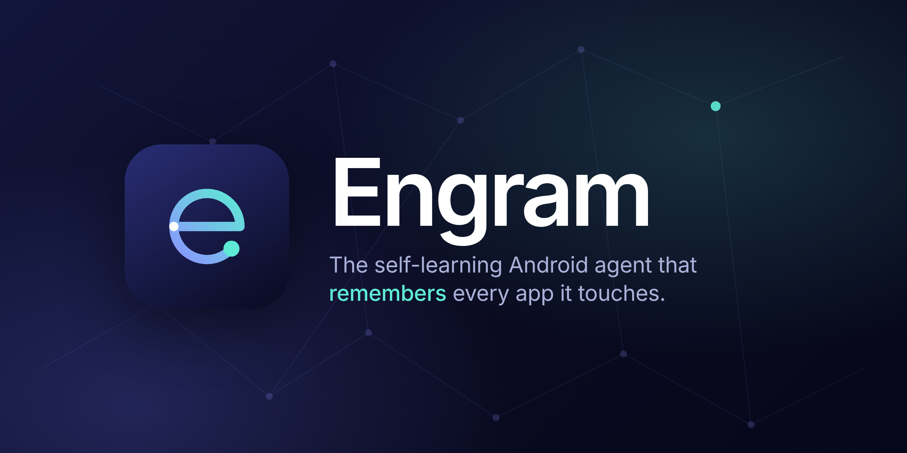
</p>

<p align="center">
  Other agents wake up with amnesia. Engram wakes up with a map.<br>
  Closed-loop memory. Graph-engineered navigation. No retraining.
</p>

<p align="center">
  <a href="https://www.python.org/downloads/"></a>
  <a href="LICENSE"></a>
  <a href="https://modelcontextprotocol.io/"></a>
  
  
</p>

---

## Every other GUI agent starts from zero. Every time.

Ask a typical phone agent to turn on dark mode. It squints at the home screen, guesses, wanders, and finds Settings. Ask again tomorrow and it does the same thing, because it has forgotten everything it learned.

**Engram closes the loop.** An *engram* is the trace a memory leaves behind in a brain. Engram builds that trace for software. Every screen it visits, every tap that worked, and every dead end becomes part of a living **cortex** for that app. The next time you ask for something, it already knows where the road goes.

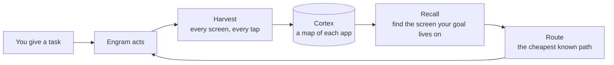

|  | A typical agent | Engram |
|---|---|---|
| Knows the app | Never. It looks again each task. | Yes. It keeps a map of every app version it has seen. |
| After a task | Everything is thrown away. | Every screen and action joins the cortex. |
| Finding a goal | Guess and scroll. | Search the cortex by meaning, then plan a route. |
| Learning loop | Open. Nothing carries over. | Closed. It is self-learning: it feeds on its own runs, and **no weights change**. |
| When a run fails | Nothing is recorded. | The run counts for less in the map, so bad routes fade. |

### Why the cortex matters

- **A closed learning loop.** Every run feeds the cortex, and the cortex feeds the next run. The more it works, the more it has to go on. There is no retraining and no labeled data.
- **Graph engineering at the core.** Each app version becomes a state graph. Screens are nodes. Actions are edges, weighted by how often they really worked. Routes come from Dijkstra over that graph, so reliable roads win over short ones.
- **Semantic retrieval for GUIs.** Each screen gets a plain-language description and a vector embedding. A goal like "turn on dark theme" finds the Display screen through vector search and an LLM selector, with no hard-coded rule. Think RAG, but for phones.
- **A world model of every app.** The graph is a learned model of how each app behaves: where a tap leads and how reliably it gets there.
- **Self-correcting.** A failed run counts for less. Bad routes fade, and good ones strengthen.
- **Version-aware.** Maps are keyed by app package and version code, so an update does not poison what it learned.
- **Privacy by design.** The cortex stores masked structure. Typed text is never stored. Numbers, emails, and long text are masked, and descriptions are written in general terms.
- **Fault tolerant.** Memory is advisory. The agent keeps full control, and a fault in the memory layer is built not to change the result of a task. A unit test with a mock device covers it.
- **A real system, not a prompt.** Harvesting, enrichment, vector search, and routing run as separate background services with the failure handling to match.

### See it drive a real phone

<p align="center">
  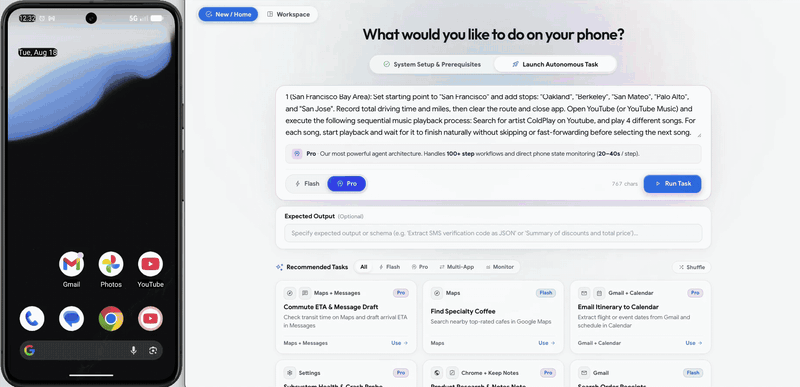
  <br>
  <em>Plans driving routes and totals the durations in Google Maps, then opens YouTube and plays a Coldplay song.</em>
</p>

### Built on a full agent stack

Engram ships with everything an agent needs on a real phone. **Flash** is a fast single-model loop. **Pro** is a multi-agent graph that plans, verifies, and recovers. An **MCP server** lets Claude Code, Cursor, Windsurf, and other IDEs drive a real device. The memory layer sits on top of both and feeds Pro its routes.

> **Honest status.** The cortex is built, merged, and covered by unit tests. It has not yet run on a real device, and its thresholds are untuned. [Status](#status) lists what is open.

This page describes how the system is built. Each section is a diagram first, with a few lines of text under it.

## Contents

1. [The system at a glance](#the-system-at-a-glance)
2. [Repository map](#repository-map)
3. [Two execution profiles](#two-execution-profiles)
4. [From screen to tap](#from-screen-to-tap)
5. [The LLM layer](#the-llm-layer)
6. [Two MCP servers](#two-mcp-servers)
7. [Data and context memory](#data-and-context-memory)
8. [App memory](#app-memory)
9. [Frameworks](#frameworks)
10. [Configuration](#configuration)
11. [Run it](#run-it)
12. [Develop](#develop)
13. [Status](#status)
14. [Origin](#origin)

## The system at a glance

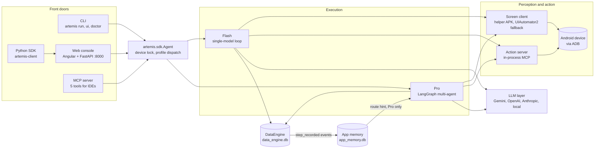

Every task goes through `artemis.sdk.Agent`. It takes a cross-process lock on the device, then runs Flash or Pro. Both profiles write each step to the DataEngine. App memory listens to those writes and learns from them.

## Repository map

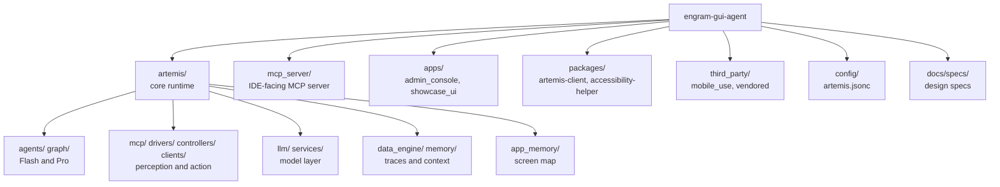

| Path | What it holds |
|---|---|
| `artemis/agents/`, `artemis/graph/` | The Flash loop, the Pro graph, and the agents behind them. |
| `artemis/mcp/`, `artemis/drivers/`, `artemis/controllers/`, `artemis/clients/` | Screen capture and action execution. |
| `artemis/llm/`, `artemis/services/llm.py` | Model routing, fallback, structured output. |
| `artemis/data_engine/`, `artemis/memory/` | Trace storage and context compression. |
| `artemis/app_memory/` | The learned screen map. |
| `mcp_server/` | The MCP server that IDEs talk to. |
| `apps/admin_console/`, `apps/showcase_ui/` | FastAPI backend and Angular front end. |
| `packages/artemis-client/` | Zero-dependency Python client for the daemon. |
| `packages/artemis-accessibility-helper/` | Java APK that reads the screen on the phone. |
| `third_party/mobile_use/` | Vendored subset of Minitap's mobile-use. |
| `docs/specs/` | Design specs and decision records, one folder per feature. |

## Two execution profiles

`third_party/mobile_use/sdk/agent.py` picks the profile. `flash` runs `FlashRunner`. Anything else runs the Pro graph. The default is Pro.

| | Flash | Pro |
|---|---|---|
| Shape | One model in a loop | LangGraph of several agents |
| Plan | None | Planner writes milestones and checks |
| Safety net | None | Checks the target before each action |
| Verification | None | Read-only Checker, set by `verification_level` |
| App memory hints | No | Yes |
| Ends when | The model calls `report_task_status` | All top-level milestones are done |

### Flash

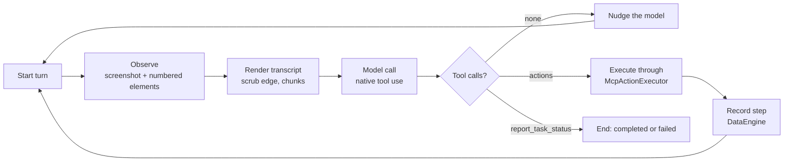

### Pro

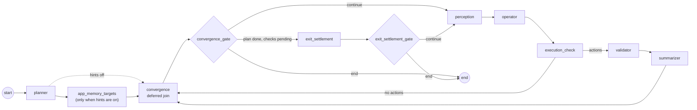

The loop is `perception → operator → execution_check → validator → summarizer → convergence`. The Checker and the planner's validation run as background tasks inside `execution_check` and `exit_settlement`. They are not graph nodes.

### Pro agents

| Agent | Job |
|---|---|
| `planner` | Writes the task plan once: milestones plus `verify` and `assert` checks. |
| `operator` | Reads the screen and plan each turn, calls tools, and emits an action list. |
| `validator` | Runs the actions. A single action passes the safety net first (XML, then pixel). Two or more run as a burst. |
| `summarizer` | Hands the step to the background step-memory service. |
| `checker` | Read-only audits against the plan: per checkpoint and at exit. |
| `explorer` | Finds hard-to-locate UI. Three tiers: flash, pro, ultra. |
| `diagnoser` | Finds the root cause of a failure. |
| `history_analyzer`, `log_analyzer` | Answer questions about past steps and logcat output. |
| `object_detector`, `image_processor` | Visual grounding and image tools for the Explorer. |
| `video_analyzer` | Reads the scrcpy session recording. |
| `outputter` | Writes the final report. |

## From screen to tap

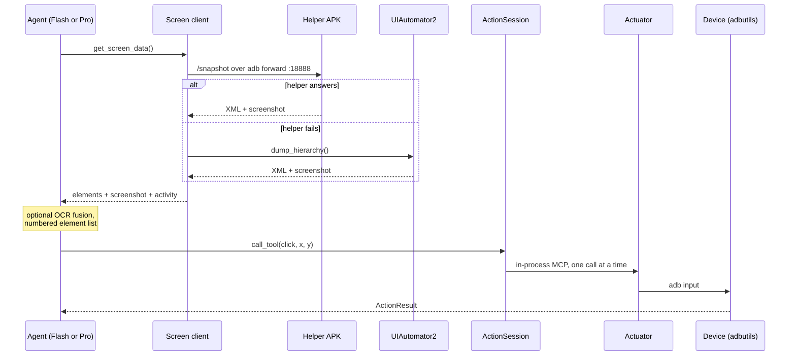

**Perception.** `FallbackScreenClient` tries the helper APK first and falls back to UIAutomator2. It retries the helper after 30 seconds. Set `ARTEMIS_HIERARCHY_BACKEND` to `helper` or `uiautomator` to pin one. OCR through Google Vision is optional and fuses with the hierarchy.

**Action.** `ActionSession` is an in-memory MCP client and server pair. It serializes calls, so only one action touches the device at a time. Coordinates are normalized to 0 to 1000.

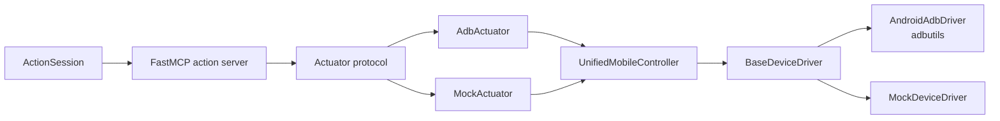

The action surface is defined in `artemis/mcp/action_manifest.py`. `click_sequence` is required. Other actions such as `swipe`, `input_text`, `press_key`, and `manage_app` are optional per actuator.

## The LLM layer

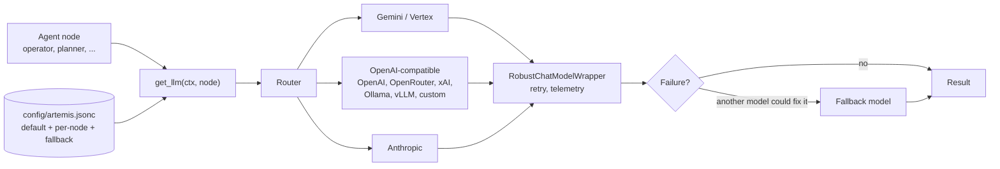

- Each agent node has its own model, with an optional fallback. Nodes without an override inherit `default`.
- `acomplete_structured` parses JSON and asks the model once to correct a bad reply.
- A circuit breaker and a failure classifier (`rate_limit`, `timeout`, `authentication`, and others) decide when to retry or switch.
- When retries run out, the task pauses on a pause file. Background jobs such as app-memory description raise `LLMExhaustedError` instead of pausing the run.
- `ARTEMIS_FAKE_LLM=1` swaps in a fake model for tests.

## Two MCP servers

The repository holds two unrelated MCP servers.

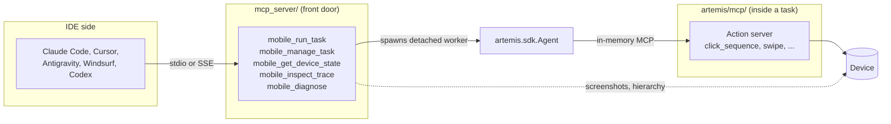

- `mcp_server/` is what your IDE connects to. `mobile_run_task` starts a detached worker and returns, and `mobile_manage_task` checks status, stops, or injects an instruction.
- `artemis/mcp/` is how agents touch the device during a task. It runs in memory with no network.
- `artemis mcp --install <client>` writes the config and the behavior rules in `mcp_server/rules.md` for a given IDE. Details are in [`mcp_server/README.md`](mcp_server/README.md).

## Data and context memory

### DataEngine

Every step lands in one SQLite file, with screenshots stored by content hash.

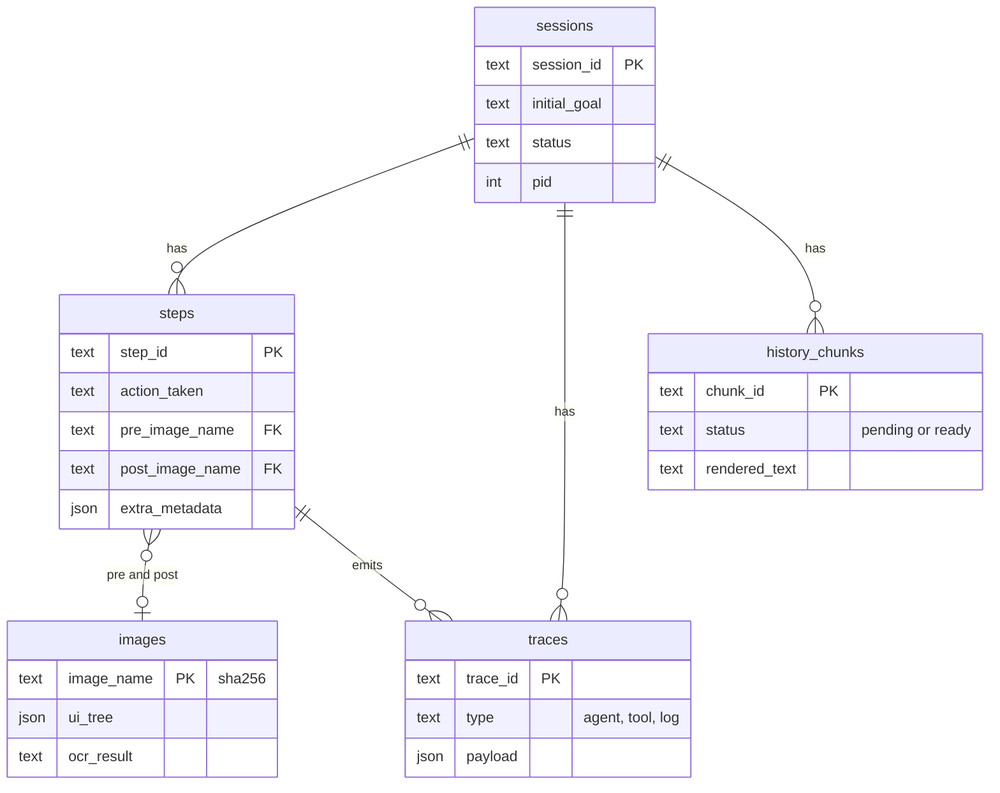

`extra_metadata` on each step carries `foreground_app`, `activity`, `version_code`, `version_name`, `ui_backend`, and a perceptual hash of the screenshot. App memory relies on those fields. Files live under the traces directory: `data_engine.db`, `images/<sha256>.jpg`, and one folder per session.

### Context memory

Both profiles keep the conversation in a `TranscriptLedger`, so a long run does not grow without bound.

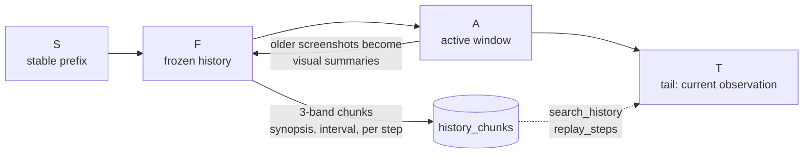

## App memory

App memory builds a map of each app version from what the agent actually did. Screens are states with their variable content masked. Actions that moved between them are edges. For each plan milestone, the Pro graph finds the target screen in the map, finds the cheapest route from the current screen, and shows that route to the Operator as advisory text. Execution is unchanged.

### Pipeline

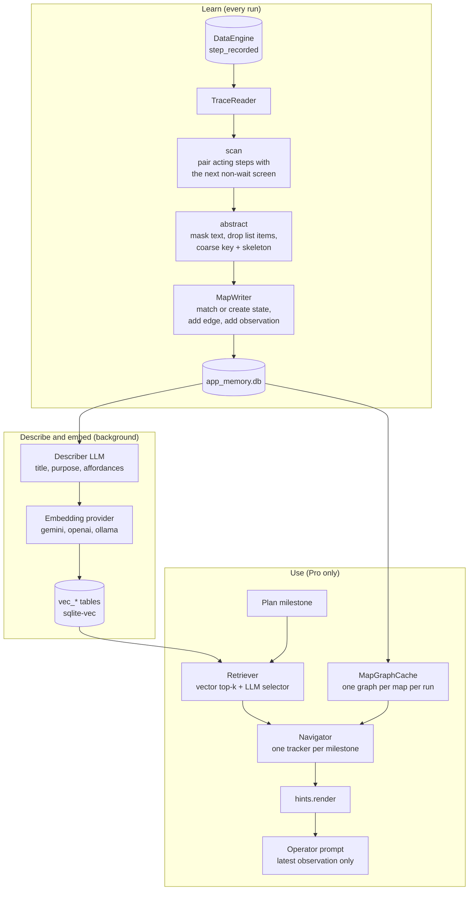

### One run

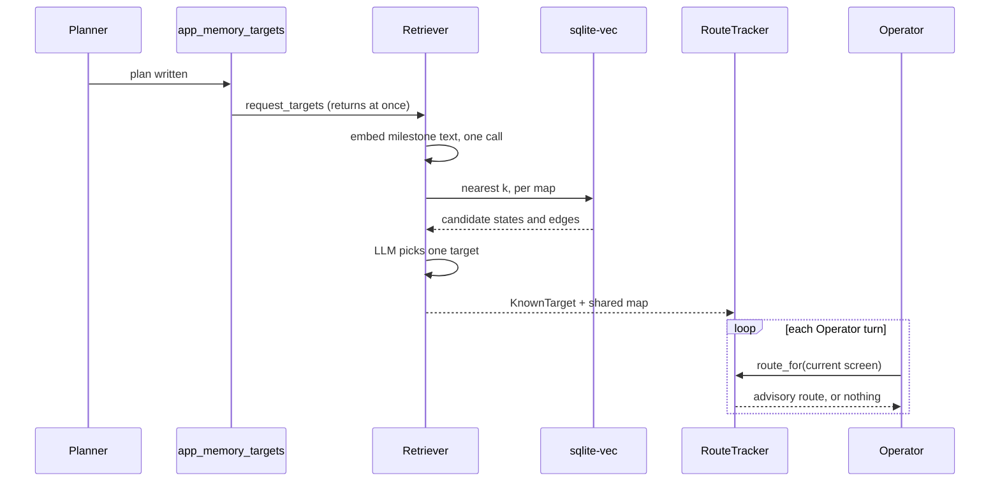

The Operator never waits on retrieval. Until a target is found, `route_for` returns nothing and the prompt is unchanged.

### Store

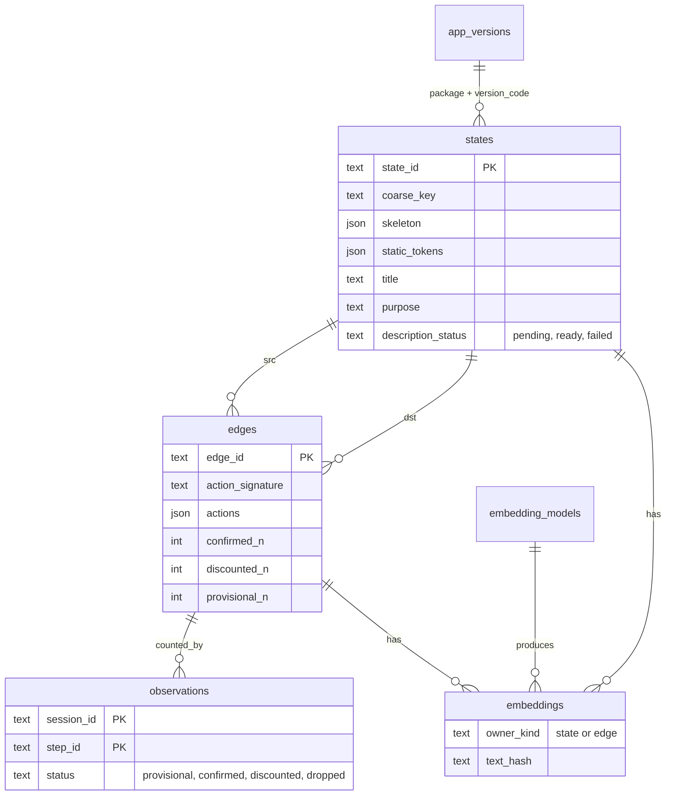

A map is one app package plus one `version_code`. There is no `maps` table. Vectors live in one sqlite-vec `vec0` table per embedding model, partitioned by map. Descriptions are embedded once and re-embedded only when their text changes. A query embeds only the milestone text.

### How a route is chosen

Each edge costs `-ln(p) + 0.1`, where `p` is the edge's observed success rate under a Beta(1, 1) prior. Confirmed observations count 1.0, provisional 0.5, discounted 0.25. Rustworkx runs Dijkstra over the shared graph, capped at 15 hops. Ties go to fewer hops, then to the more recently seen path.

| Stage | Where | Key constants |
|---|---|---|
| State match | `abstraction/matching.py` | 0.60 skeleton + 0.40 static tokens, threshold 0.80 |
| Vector search | `retrieval/` | top-k 20, similarity floor 0.35 |
| Selector | `retrieval/selector.py` | minimum confidence 0.5 |
| Routing | `routing/` | 15 hops, hop cost 0.1 |

These constants are starting values. Real data has not tuned them yet.

Design notes and the settled decisions are in [`docs/specs/app-memory/`](docs/specs/app-memory/README.md).

## Frameworks

| Layer | Framework | Used for |
|---|---|---|
| Orchestration | LangGraph | The Pro graph and its state. |
| Models | LangChain, `langchain-google-genai`, `-vertexai`, `-openai`, `-anthropic` | Chat models for every provider. |
| Gemini native | `google-genai` | Files API, caching, and token counting for video analysis. |
| Tool protocol | `mcp` (FastMCP) | The IDE server and the in-process action server. |
| Device | `adbutils`, `uiautomator2`, scrcpy | ADB control, hierarchy fallback, screen recording. |
| Android helper | Java, Gradle, no dependencies | A 37 KB accessibility service that serves the UI tree. |
| Backend | FastAPI, uvicorn, SSE | Admin console and task queue. |
| Front end | Angular 22, RxJS | The web console. |
| CLI | Typer, Rich | The `artemis` command. |
| Config | Pydantic, pydantic-settings, JSONC | Typed config and state. |
| Storage | SQLite (WAL), `sqlite-vec` | Traces, the screen map, and vector search. |
| Graph search | `rustworkx` | Dijkstra over the screen map. |
| Imaging | Pillow, OpenCV, NumPy | Hashing, diffs, overlays. |
| Tooling | uv, ruff, pyright, pytest | Build, lint, types, tests. |

## Configuration

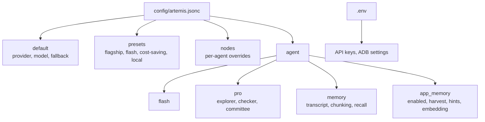

- One file, `config/artemis.jsonc`, with an identical copy bundled in the wheel.
- Pick the profile per task with `--profile flash|pro`, the SDK `TaskRequest.profile`, or the MCP `model` argument.
- App memory switches: `agent.app_memory.enabled`, `.harvest.enabled`, `.hints.enabled`. Hints need all three. Retrieval and descriptions need `GEMINI_API_KEY`, or the key for the embedding provider you configure.
- The checker level is `off`, `final`, `checkpoints`, or `strict`.

## Run it

You need Python 3.12 or later, `uv`, and an Android device with USB debugging on, or an emulator.

```bash
git clone https://github.com/leong1024/engram-gui-agent.git
cd engram-gui-agent
./start.sh          # installs the toolchain and opens the web console
```

On Windows, run `.\start.bat` instead.

```bash
uv run artemis doctor                                   # check the setup
uv run artemis run "Open Settings and read the battery level" --profile flash
uv run artemis run "Turn on dark theme" --profile pro
uv run artemis mcp --install all                        # connect your IDEs
uv run artemis app-memory stats                         # inspect the learned map
```

**On the phone.** The first task installs a small accessibility service, the Artemis helper. It listens on `127.0.0.1` only. Use `artemis helper install`, `status`, or `uninstall` to manage it, or set `ARTEMIS_HIERARCHY_BACKEND=uiautomator` to skip it.

## Develop

| Command | What it does |
|---|---|
| `make lint` | `ruff format --check`, `ruff check`, and the quality ratchet. |
| `make typecheck` | `pyright` on the typed core in `pyright-core.json`. |
| `uv run pytest tests/unit -q` | Unit tests. They need no device. |
| `make test-device` | Tests that need a connected phone. |

The quality ratchet in `scripts/quality_ratchet.py` caps three counts against `.quality-baseline.json`: broad exception handlers, `type: ignore` comments, and functions over 100 lines. A count can fall but not rise. The rules for contributors are in [`CLAUDE.md`](CLAUDE.md).

Set `GEMINI_API_KEY=dummy` to run the full unit suite without a real key. CI runs lint, the ratchet, the typed core, the front-end tests, and a wheel build. It runs the Python unit tests only on manual dispatch.

## Status

| Area | State |
|---|---|
| Flash and Pro profiles | Working. |
| App memory, code | Merged and covered by unit tests. |
| App memory, on a device | **Not yet run.** The device and perf checks in `docs/specs/app-memory/implementation-plan.md` are open. |
| App memory, tuning | Open. The thresholds above, the 20-label limit in state documents, and the single frozen description per state need real scores. |
| Cloud devices | `playground/` has sample deployment code. Treat it as unsupported. |

Hints and harvesting are on by default in `config/artemis.jsonc`.

## Origin

This repository started as an import of [google/artemis](https://github.com/google/artemis) and keeps its Apache-2.0 license. App memory (`artemis/app_memory/` and its specs) is new work here.

Third-party code lives under [`third_party/`](third_party/), one directory per upstream project, each with its own `LICENSE` and `METADATA`.

- [`third_party/mobile_use`](third_party/mobile_use/): portions of [mobile-use](https://github.com/minitap-ai/mobile-use) by Minitap, Inc., Apache License 2.0.

Licensed under the [Apache License 2.0](LICENSE).
